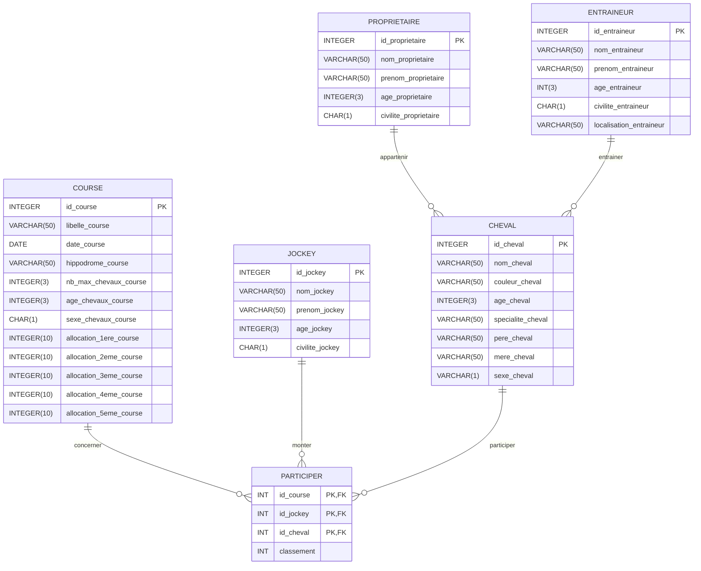

# Gestion de courses hippiques

## Présentation du projet

> **Gestion de courses hippiques** est une application de bureau développée en C# dans le cadre d'un **Projet d'Étude Encadré (PEE)**.
L'application est destinée à **FRANCE GALOP**, l'organisme chargé de l'organisation et de la gestion des courses hippiques en France.
Son objectif est de centraliser la gestion des chevaux, des entraîneurs, des courses hippiques, des engagements ainsi que des résultats.
Le projet repose sur une architecture en couches de type MVC et utilise Microsoft SQL Server pour le stockage des données.

## Objectifs

Cette application doit permettre de :

- Gérer les chevaux et leurs informations.
- Gérer les entraîneurs et consulter les chevaux qu'ils entraînent.
- Gérer les courses hippiques et leurs caractéristiques.
- Enregistrer les engagements des chevaux dans les courses.
- Vérifier automatiquement les conditions d'engagement.
- Saisir et valider les résultats des courses.
- Calculer les allocations financières attribuées aux chevaux selon leur classement.

## Technologies utilisées

## Schéma du Modèle Entité-Association (MEA)

